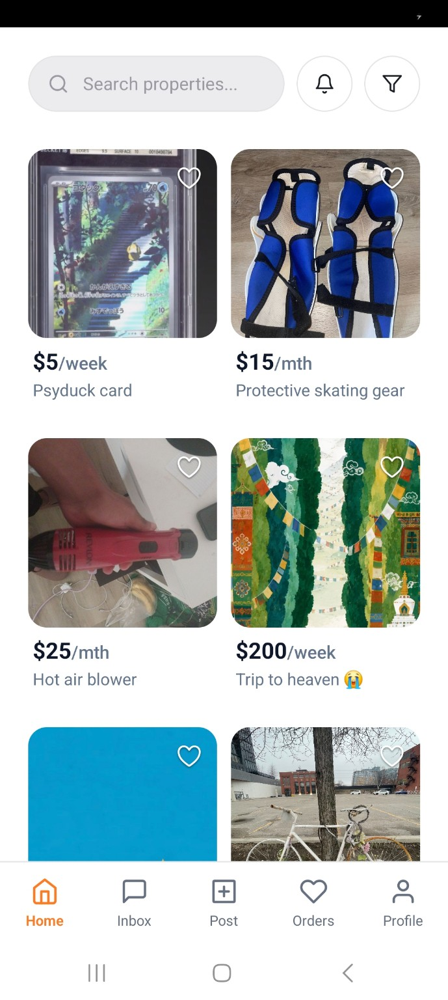
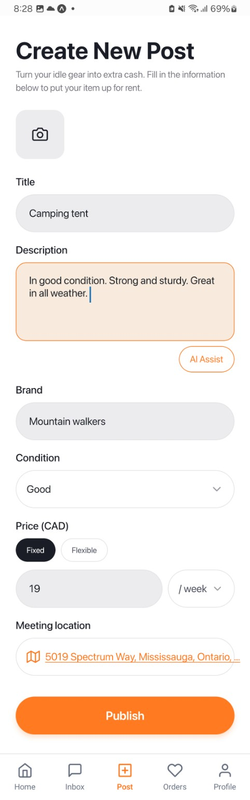
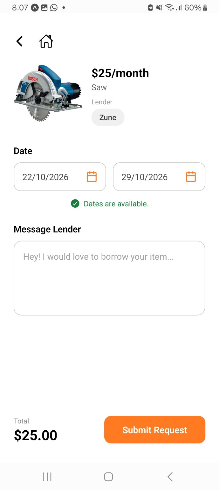
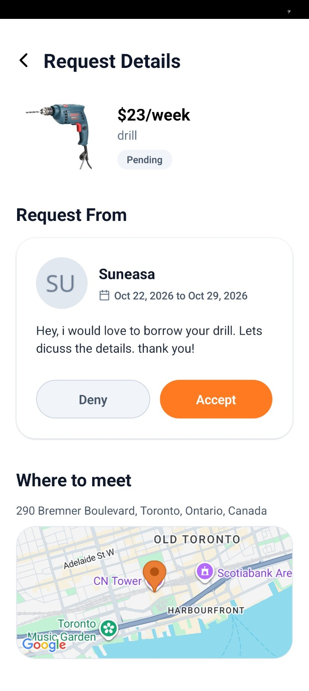
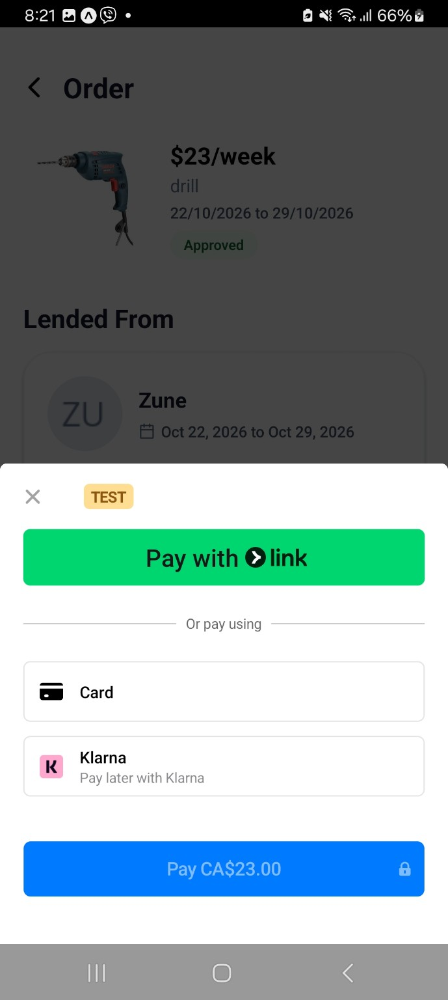
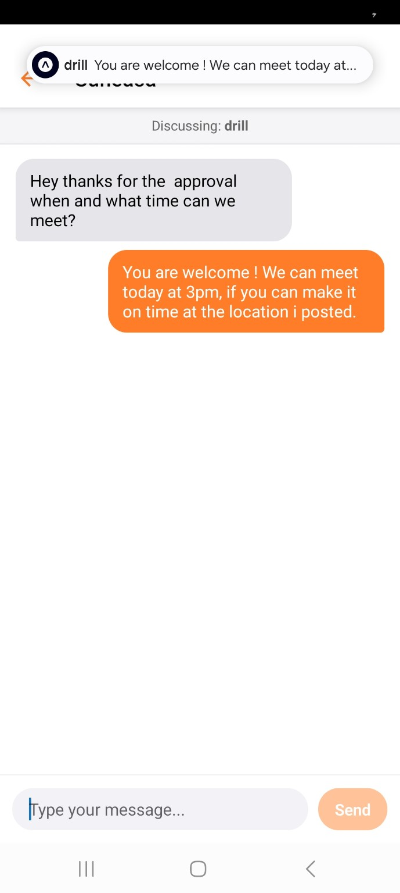
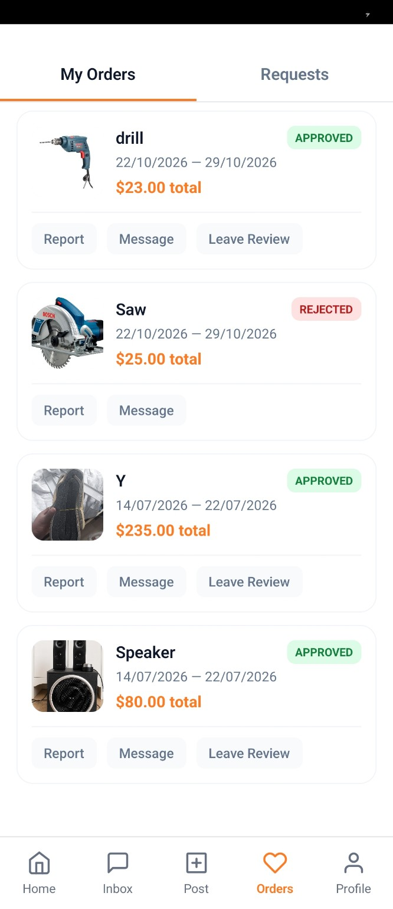

<p align="center">

  

</p>

# OOPA

### Rent what you need. Earn from what you own.

**A peer-to-peer rental marketplace built with React Native, TypeScript, Expo, and Firebase.**

OOPA connects people who want to rent everyday items with people who have items to share. Users can publish listings, browse and save products, request rentals for specific dates, communicate with owners, pay for approved rentals, and leave reviews, all within one mobile app.

Built as a two-person collaborative project, OOPA combines a cross-platform interface with real-time data, server-controlled rental workflows, Stripe payments and subscriptions, and Firebase security rules.

> **Project status:** Portfolio / demonstration project. Payment screenshots show **Stripe test mode**, not live transactions. Running the app requires your own Firebase and Stripe configuration.

## Tech stack

| Layer | Technologies |

| --- | --- |

| **Mobile app** | React Native, TypeScript, Expo, React Navigation |

| **Authentication and data** | Firebase Authentication, Cloud Firestore, Firebase Storage |

| **Backend** | Firebase Cloud Functions, Node.js, TypeScript |

| **Payments and billing** | Stripe PaymentIntents, PaymentSheet, subscriptions, webhooks |

| **Maps and notifications** | React Native Maps, Expo Notifications |

| **Testing** | Node.js test runner, Firebase Emulator Suite, Firestore security-rule tests |

## App walkthrough & screenshots

### 1. Discover available items

Browse a feed of rentable items, search listings, save favorites, and filter by condition, price range, and pricing type.
<p align="center">
  
</p>


### 2. Explore listing details

See item images, pricing, condition, reviews, owner information, and a map of the meeting location before requesting a rental.
<p align="center">
  
</p>


### 3. Publish a listing

Owners can create listings with images, descriptions, item condition, rental price, pricing interval, and meeting location.
<p align="center">
  
</p>


### 4. Request a rental

Renters choose dates, check availability, and submit a request to the listing owner. The backend checks rental availability and guards approval against conflicting bookings.
<p align="center">
  
</p>


### 5. Accept or decline requests

Owners can inspect pending requests and accept or decline them. Approval is validated on the server; payment state also restricts changes to certain rental decisions.
<p align="center">
  
</p>


### 6. Pay through Stripe (test mode)

Approved rentals can enter a Stripe payment flow. Backend Cloud Functions create and validate payment intents; webhook handling updates payment records after Stripe events.
<p align="center">
  
</p>


### 7. Coordinate through real-time messaging

Approved rental participants can use rental-specific chat to discuss pickup, timing, and other arrangements, with notifications for relevant activity.
<p align="center">
  
</p>


### 8. Track rental activity

Renters and owners can view requests and orders, see statuses such as pending, approved, or rejected, and access actions including messaging and reviews.
<p align="center">
  
</p>


## Key features

| Feature | Implementation |

| --- | --- |

| **Accounts & profiles** | Firebase Authentication, persistent sessions, profile management |

| **Listings** | Create, update, and delete items with photos, pricing, condition, and location |

| **Discovery** | Search and filter listings; save items to a user-specific collection |

| **Rental workflow** | Date-based requests, availability checks, approval and rejection |

| **Messaging** | Rental-related chats backed by Firestore real-time listeners |

| **Payments** | Stripe PaymentIntents and mobile payment collection for approved rentals |

| **Subscriptions** | Monthly/yearly OOPA Pro plans and server-enforced listing allowances |

| **Notifications** | In-app rental updates and Expo push-notification integration |

| **Reviews** | Item ratings and post-rental feedback |

## Engineering highlights

### Server-controlled rental approvals

OOPA uses Firebase Cloud Functions to validate rental availability and owner decisions. Server-side checks cover ownership, overlapping booking dates, and payment-related restrictions. Firestore transactions help handle competing approvals consistently.

### Stripe integration and payment state

Payment processing was one of the most technically demanding parts of the project. The mobile client invokes Cloud Functions to start approved rental payments. Server-side code creates Stripe PaymentIntents, checks trusted rental and payment data, and processes Stripe webhook events to update transaction status. Separate Cloud Functions handle subscription creation and billing management.

### Firestore security rules

Firestore security rules enforce user-specific access to data such as chats and notifications, constrain writes to rental records, and protect server-owned data. Emulator-based tests check that authorized operations succeed and unauthorized operations fail.

### Organized client architecture

The mobile code separates UI screens and reusable components from view-model hooks, typed domain models, authentication context, navigation, and service modules. The service layer manages Firebase, rentals, listings, messaging, Stripe, storage, and notifications.

### Listing limits and subscriptions

The backend enforces a limit of **three active listings** for free accounts. OOPA Pro entitlement state is used to determine expanded listing access, rather than relying solely on client-side UI checks.

## Architecture

```text

                      React Native / Expo (TypeScript)

                                 |

          +----------------------+----------------------+

          |                      |                      |

       Screens               View-models           UI Components

          |                      |                      |

          +----------------------+----------------------+

                                 |

                         Service modules

                 (auth, rentals, listings, chat,

                  payments, storage, notifications)

                                 |

                 +---------------+---------------+

                 |                               |

         Firebase client SDK             Firebase Cloud Functions

         - Authentication               - Listing & plan validation

         - Firestore listeners          - Rental availability/approval

         - Cloud Storage                - Payment intents & webhooks

                 |                      - Subscriptions & notifications

                 |                               |

                 +------------ Firestore --------+-------- Stripe API

           Firestore security rules govern client data access

```

### Repository structure

```text

OOPA/

├── screens/                  # App screens and user-facing flows

├── components/               # Reusable UI elements

├── viewModels/               # Screen state and workflow hooks

├── navigation/               # Auth and application navigation

├── context/                  # Shared authentication context

├── services/                 # Firebase, rental, chat, Stripe, etc.

├── types/                    # Typed application models

├── functions/src/            # Cloud Functions / server-side logic

├── functions/test/           # Backend tests

├── tests/                    # Pricing and Firestore rule tests

├── firestore.rules           # Firestore access-control rules

└── docs/screenshots/         # Portfolio screenshots

```

## My role & team collaboration

OOPA was built by a **two-person team**. **My primary contribution was backend development and integrations**, particularly the Stripe payment infrastructure, Firebase Cloud Functions, and Firestore-related workflows and security work. My teammate **Bibek** focused on the frontend implementation, interface design, and visual styling. We coordinated to connect the client experience with the backend services.

**A key learning experience:** Stripe was new to us. I took responsibility for integrating the mobile payment experience with server-side PaymentIntent creation, webhook handling, and Firestore payment status updates. The project also involved learning and applying Firestore security rules and collaborative Git/GitHub workflows. We used AI coding assistants as development tools alongside hands-on integration and testing.

## Getting started

> **Note:** This repository relies on a Firebase project and Stripe configuration. The steps below are intended as a development setup outline, **not** a one-command production deployment. Native Stripe integration and push notifications may require an Expo development build rather than Expo Go.

### Requirements

- Node.js and npm

- Android Studio or Xcode for native builds

- Firebase CLI and a Firebase project

- A Stripe account configured for **test mode**

- Node.js **24** for the `functions/` package (per `functions/package.json`)

### 1. Clone and install

```bash

git clone https://github.com/giga-sune/OOPA.git

cd OOPA

npm ci

```

### 2. Configure Firebase and client environment

Set up Firebase Authentication, Firestore, Storage, and Cloud Functions in a Firebase project you control. Update `services/firebase/firebaseConfig.ts` and `.firebaserc` to point to your project.

Create a local `.env.local` in the repository root:

```dotenv

EXPO_PUBLIC_STRIPE_PUBLISHABLE_KEY=your_stripe_test_publishable_key

# Optional: local Cloud Functions emulator hostname

# EXPO_PUBLIC_FUNCTIONS_EMULATOR_HOST=your_emulator_host

```

**Security:** Variables prefixed `EXPO_PUBLIC_` are included in the client bundle. Never put Stripe secret keys, webhook secrets, or other private credentials there. The AI listing-description helper is currently **development-only**.

### 3. Install and configure Cloud Functions

```bash

cd functions

npm ci

npm run build

cd ..

```

Configure the backend's Stripe plan / product identifiers and billing-portal settings for your own test account. Keep `STRIPE_SECRET_KEY` and `STRIPE_WEBHOOK_SECRET` in Firebase-managed secrets, not in source code:

```bash

firebase functions:secrets:set STRIPE_SECRET_KEY

firebase functions:secrets:set STRIPE_WEBHOOK_SECRET

```

### 4. Start a native development build

```bash

npx expo run:android

# or on macOS with Xcode:

npx expo run:ios

```

`npm start` launches Metro, but Expo Go may not support all native Stripe / notification features used by this app.

## Testing

The repository includes tests for billing and listing validation, rental approval guardrails, subscription pricing, and Firestore access controls.

From the project root:

```bash

npm run test:subscription-pricing

npm run test:firestore:rules

```

From `functions/`:

```bash

npm test

```

Some backend tests require the Firestore emulator and `FIRESTORE_EMULATOR_HOST`; emulator-dependent cases are skipped without that configuration. These commands describe available test suites, not a claim that every test was run successfully in this README review.

## Development notes

- OOPA is a **portfolio/demo project**, not a claim of production-scale reliability or a publicly deployed marketplace.

- Stripe integration is demonstrated in **test mode**.

- The AI Assist description feature is development-only in the current source.

## Credits

**Backend development & integrations:** Sune Geleta  

**Frontend development & visual design:** Bibek Gurung  

**Project:** Collaborative mobile application development

## Source code

[github.com/giga-sune/OOPA](https://github.com/giga-sune/OOPA)